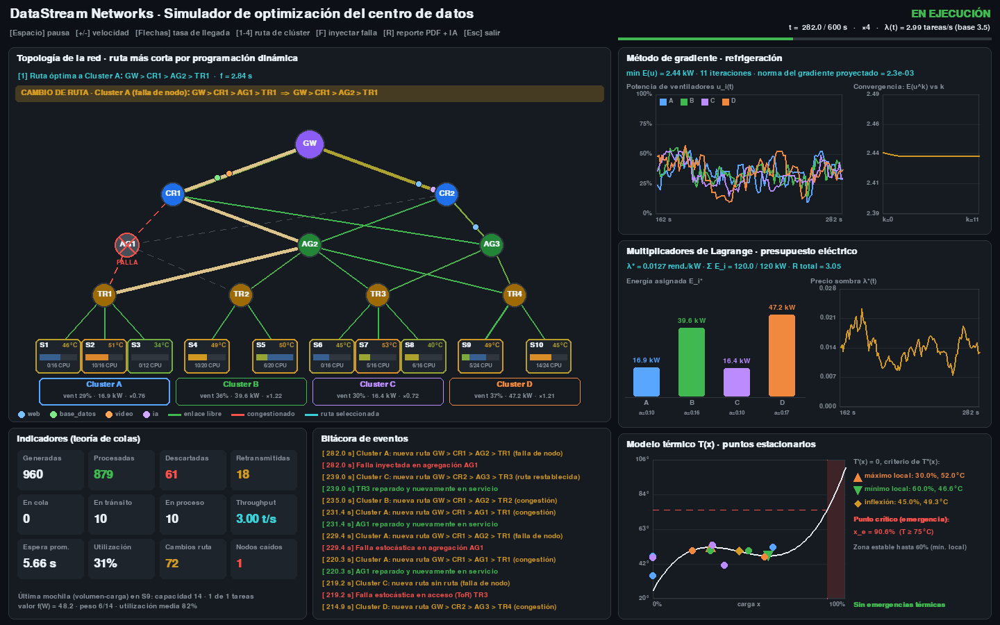

# DataStream Networks · Simulador de optimización para centros de datos

Proyecto de **Métodos Cuantitativos** (Universidad José Antonio Páez · Escuela de Ingeniería en Computación · octubre 2026).

Simulador visual del tráfico de red y de la asignación de recursos de un centro de datos. Usa **SimPy** para la
simulación de eventos discretos, **Pygame** para el dashboard en tiempo real, y modelos de **programación dinámica**
y **optimización no lineal** para tomar decisiones. Al final genera un **reporte PDF** con un análisis escrito por la
**API de DeepSeek**.



---

## Contenido

1. [Instalación](#instalación)
2. [Uso](#uso)
3. [Arquitectura](#arquitectura)
4. [Módulo 1 · Programación dinámica](#módulo-1--programación-dinámica)
5. [Módulo 2 · Optimización no lineal](#módulo-2--optimización-no-lineal)
6. [Módulo 3 · Simulación, visualización e IA](#módulo-3--simulación-visualización-e-ia)
7. [Datos de configuración](#datos-de-configuración)
8. [Validaciones](#validaciones)
9. [Pruebas](#pruebas)

---

## Instalación

Se necesita **Python 3.10 o superior**.

```bash
git clone https://github.com/nox456/datastream-simulador.git
cd datastream-simulador
python -m venv .venv
# Windows: .venv\Scripts\activate    ·    Linux/macOS: source .venv/bin/activate
pip install -r requirements.txt
```

**Análisis con IA (opcional):** copie `.env.example` como `.env` y coloque su `DEEPSEEK_API_KEY`. Sin clave, el
reporte PDF se genera igual, con un análisis basado en reglas.

## Uso

```bash
python main.py                        # menú interactivo (todas las opciones, con validación de datos)
python main.py simular                # dashboard en tiempo real
python main.py simular --sin-gui      # simula sin ventana y genera el reporte PDF en reportes/
python main.py simular --duracion 300 --tasa 5 --semilla 7 --velocidad 8
python main.py --config mi_red.json simular   # usar otra configuración
```

Cada módulo matemático también se puede ejecutar **de forma independiente** por consola:

| Comando | Qué muestra |
|---|---|
| `python main.py ruta [--falla CR1] [--destino TR4]` | Tablas de la recursión hacia adelante y hacia atrás, y la ruta óptima a cada clúster |
| `python main.py ruta --ejemplo-clase` | Ejemplo de clase de las 7 ciudades (1 → 4 → 5 → 7, 21 km) por ambas recursiones |
| `python main.py mochila [--capacidad 12 --tareas 8]` | Modelo de volumen-carga con la tabla `f_i(w)` y las tareas elegidas |
| `python main.py mochila --ejemplo-clase` | Ejemplo de clase del barco de 4 t (varias unidades por artículo, $62.000) |
| `python main.py temperatura [--emergencia 80]` | `T(x)`, `T'(x)`, `T''(x)`, puntos estacionarios, inflexión y punto crítico |
| `python main.py gradiente [--cargas 0.9,0.5,0.2,0.7]` | Iteraciones del método de gradiente hasta converger |
| `python main.py lagrange [--presupuesto 150]` | Lagrangiano, derivadas parciales, `λ*`, reparto óptimo de energía y Hessiano orlado |

### Controles del dashboard

Cada acción se puede hacer **con el teclado o con el mouse**: los botones del encabezado muestran su tecla
equivalente, y un clic sobre el recuadro de un clúster resalta su ruta.

| Tecla | Botón / clic | Acción |
|---|---|---|
| `Espacio` | `Pausa` / `Reanudar` | Pausar / reanudar |
| `+` / `-` | `Velocidad +` / `Velocidad −` | Velocidad de la simulación (×0.5 a ×32) |
| `↑` / `↓` | `Tasa +` / `Tasa −` | Aumentar / disminuir la tasa de llegada de tareas (0.5 a 20 tareas/s) |
| `1` … `4` | Clic en el recuadro del clúster | Resaltar la ruta óptima hacia ese clúster |
| `F` | `Falla` | Inyectar una falla en un router al azar (para ver el reenrutamiento) |
| `R` | `Reporte PDF` | Generar el reporte PDF con análisis de IA (incluye una captura del dashboard) |
| `Esc` | `Salir` | Salir |

## Arquitectura

Arquitectura limpia **ligera**: el núcleo matemático no conoce a SimPy, Pygame ni a la IA, y cada capa solo depende
de las capas internas.

```
main.py                     punto de entrada
datos/
  configuracion_default.json   datos de prueba por defecto
datastream/
  dominio/                  entidades: Nodo, Enlace, Topologia, Servidor, Cluster, Tarea
  modelos/                  núcleo matemático puro (independiente y probado)
    ruta_mas_corta.py         programación dinámica por etapas
    mochila.py                modelo de volumen-carga
    temperatura.py            análisis con derivadas (sympy)
    refrigeracion.py          método de gradiente
    presupuesto.py            multiplicadores de Lagrange
    colas.py                  referencia M/M/c y ley de Little
  simulacion/               casos de uso en el tiempo (SimPy)
    centro_datos.py           procesos: llegadas, despacho, tránsito, proceso, fallas, control
    metricas.py               indicadores y bitácora
    resumen.py                datos planos para el reporte
  visualizacion/            dashboard Pygame (topología, gráficos, indicadores)
  reportes/                 análisis con IA (DeepSeek), gráficas matplotlib y PDF (reportlab)
  configuracion.py          carga y validación del JSON
  consola.py / cli.py       demos por consola, subcomandos y menú interactivo
tests/                      pruebas unitarias y de integración (pytest)
```

```
 cli / visualizacion / reportes   →   simulacion   →   modelos + dominio
        (presentación)               (casos de uso)       (núcleo)
```

Todo está programado con **orientación a objetos** (`RutaMasCortaDP`, `ModeloVolumenCarga`, `ModeloTermico`,
`OptimizadorRefrigeracion`, `AsignadorEnergia`, `SimuladorCentroDatos`, `Dashboard`, `GeneradorReportePDF`, …).

## Módulo 1 · Programación dinámica

### Ruta más corta (menor latencia)

La red está organizada en **etapas** como el problema de la diligencia: `GW → núcleo (CR) → agregación (AG) → acceso (TR)
→ servidores`. Se usa la **recursión hacia adelante**:

```
f_0(GW) = 0
f_k(y)  = min { f_(k-1)(x) + d(x, y) }   para todo x de la etapa k-1
```

`d(x, y)` es la latencia **actual** del enlace: `latencia_base · (1 + factor · congestión)`, donde la congestión es el
promedio móvil de paquetes en el enlace. Los nodos caídos se excluyen. La ruta se recalcula cada segundo; si cambia por
congestión o por una falla, el dashboard la resalta (ruta vieja en rojo discontinuo y nueva en amarillo) y lo anota en
la bitácora. Para evitar oscilaciones, la ruta en uso solo se reemplaza si deja de ser válida o si la óptima es al menos
8 % más rápida (el reporte muestra ambas: la óptima de la DP y la ruta en uso).

En la consola también se resuelve con la **recursión hacia atrás**, la forma preferida en la literatura, hacia un
destino fijo. Ambas dan la misma ruta y la misma latencia:

```
f_n(destino) = 0
f_i(x_i)     = min { d(x_i, x_(i+1)) + f_(i+1)(x_(i+1)) }
```

### Modelo de volumen-carga (mochila 0/1)

Cada medio segundo el despachador decide qué tareas de la cola recibe cada servidor:

```
f_i(w) = max{ f_(i-1)(w),  v_i + f_(i-1)(w - w_i) }    (si w_i <= w)
```

- `w`: capacidad libre del servidor (unidades de CPU/RAM).
- `w_i`: recursos que pide la tarea `i`.
- `v_i = prioridad · cpu · (1 + espera / espera_máxima)`: valor con bonificación por antigüedad para evitar la inanición.

Los servidores en emergencia térmica no reciben tareas nuevas (protección térmica).

Cada tarea es única, por eso la simulación usa la mochila 0/1. El modelo general visto en clase, con varias unidades por
artículo, también está implementado (`ModeloMochilaUnidades`, recursión hacia atrás); la versión 0/1 es su caso
particular `m_i ∈ {0, 1}`:

```
f_i(x_i) = max { r_i·m_i + f_(i+1)(x_i − w_i·m_i) },   m_i = 0, 1, …, ⌊x_i / w_i⌋
```

## Módulo 2 · Optimización no lineal

### Análisis térmico (una variable)

`T(x) = 0.0004x³ − 0.054x² + 2.16x + 25` relaciona la carga `x` (%) con la temperatura (°C). Con `sympy`:

| Punto | Condición | Resultado |
|---|---|---|
| Máximo local | `T'(x)=0`, `T''(x)<0` | x = 30 %, 52.0 °C |
| Mínimo local | `T'(x)=0`, `T''(x)>0` | x = 60 %, 46.6 °C (fin de la zona estable) |
| Inflexión | `T''(x)=0` con cambio de concavidad | x = 45 %, 49.3 °C |
| **Punto crítico** | `T(x_e) = 75 °C` subiendo | **x_e ≈ 90.6 %** → enfriamiento de emergencia |

En la simulación, cada servidor se acerca a `T(carga)` con inercia térmica (constante de tiempo de 15 s). Al superar
el umbral, el clúster entra en emergencia: los ventiladores pasan al 100 % y el servidor deja de recibir tareas.

### Refrigeración con el método de gradiente

```
E(u) = Σ [A·u_i³ + B·L_i²/u_i] + C·Σ_(vecinos) (u_i − u_j)²
∂E/∂u_i = 3A·u_i² − B·L_i²/u_i² + 2C·Σ_j (u_i − u_j)
u^(k+1) = Proy_[u_min, 1]( u^(k) − α·∇E(u^(k)) )
```

`u_i` es la potencia de los ventiladores del clúster `i` y `L_i` su carga. Se ejecuta cada segundo partiendo de la
solución anterior, así que la ventilación se ajusta continuamente. El dashboard muestra `u_i(t)` y la convergencia
`E(u^k)` del último ciclo.

### Presupuesto eléctrico con Lagrange

```
max Σ a_i·√E_i     s.a.  Σ E_i = E_max
L = Σ a_i·√E_i − λ(Σ E_i − E_max)
∂L/∂E_i = a_i / (2√E_i) − λ = 0     ⇒   E_i* = E_max·a_i² / Σa_j²
∂L/∂λ   = 0                          ⇒   λ* = √(Σa_i²) / (2√E_max)
```

`a_i = eficiencia · (capacidad activa / capacidad total) · (carga base + carga actual)`. `λ*` es el precio sombra: el
rendimiento que daría un kW adicional. La energía asignada cambia la velocidad de proceso del clúster (`∝ √E_i`).

Condición de segundo orden: en el **Hessiano orlado** (la fila y columna de la restricción más
`∂²L/∂E_i² = −a_i / (4·E_i^1.5)`), los menores principales de orden 3, 4, …, n+1 alternan de signo empezando por `+`,
lo que confirma que el punto es un **máximo**.

## Módulo 3 · Simulación, visualización e IA

**SimPy** (`simulacion/centro_datos.py`):

- **Llegadas aleatorias (teoría de colas):** proceso de Poisson con tasa variable `λ(t) = λ·(1 + A·sen(2πt/T))` (hora pico), generado por *thinning*.
- **Tiempo de proceso:** exponencial según el tipo de tarea (web, base de datos, video, IA).
- **Fallas estocásticas:** cada router y servidor falla con tiempo `Exp(MTBF)` y se repara con `Exp(MTTR)`. Los paquetes que encuentran un nodo caído se retransmiten, y las tareas de un servidor que falla vuelven a la cola.
- **Indicadores:** throughput, espera, utilización, descartes y una comparación con el modelo M/M/c y la ley de Little.

**Pygame** (`visualizacion/`): mapa de la topología con los paquetes en movimiento (coloreados por tipo), los enlaces
coloreados por congestión, los nodos caídos y la ruta seleccionada; aviso visual de cada cambio de ruta; gráficos en
tiempo real de los ventiladores (gradiente), la energía y `λ*` (Lagrange), y la curva térmica con los servidores encima.

**IA y PDF** (`reportes/`): el reporte incluye indicadores, la tabla de la recursión de DP, la ruta óptima y la ruta en
uso de cada clúster, una mochila representativa, los puntos estacionarios, el Hessiano orlado, gráficas de matplotlib, la bitácora y un **análisis ejecutivo generado con la API de
DeepSeek** (`deepseek-chat` a través del SDK oficial `openai`, compatible con la API de DeepSeek). Si no hay clave o la API falla, se usa un análisis
local basado en reglas. En [`docs/reporte_ejemplo.pdf`](docs/reporte_ejemplo.pdf) hay un ejemplo generado con los
datos por defecto.

## Datos de configuración

`datos/configuracion_default.json` contiene los datos de prueba por defecto. Puede copiarlo, modificarlo y cargarlo con
`--config` o con la opción 8 del menú.

| Sección | Campos principales |
|---|---|
| `simulacion` | `duracion` (s), `semilla`, `tasa_llegada` (tareas/s), `amplitud_pico`, `periodo_pico`, `intervalo_despacho`, `intervalo_rutas`, `intervalo_control`, `espera_maxima`, `factor_congestion`, `suavizado_congestion` |
| `topologia` | `etapas` (lista de listas de nodos; la etapa 0 es el gateway) y `enlaces` (`origen`, `destino`, `latencia` en s, siempre entre etapas consecutivas) |
| `clusters` | `nombre`, `switch` (nodo de la última etapa), `eficiencia`, `latencia_acceso`, `servidores` (`id`, `capacidad`) |
| `tipos_tarea` | `nombre`, `probabilidad` (deben sumar 1), `cpu` [mín, máx], `prioridad` [mín, máx] (1-10), `tiempo_servicio` medio (s) |
| `fallas` | `mtbf_router`, `mttr_router`, `mtbf_servidor`, `mttr_servidor` (s) |
| `temperatura` | `funcion` (en `x`), `carga_min`, `carga_max`, `temperatura_emergencia` (°C), `inercia` (s) |
| `refrigeracion` | `coef_ventilador` (A), `coef_calor` (B), `coef_acople` (C), `tasa_aprendizaje` (α), `tolerancia`, `max_iteraciones`, `nivel_minimo` |
| `energia` | `presupuesto_total` (kW), `carga_base` |

## Validaciones

- **Archivo de configuración:** tipos, rangos, campos obligatorios, JSON mal formado (con línea y columna), nodos
  repetidos o inexistentes, enlaces que saltan etapas, nodos inalcanzables, switches inválidos, probabilidades que no
  suman 1, tareas más grandes que el servidor más pequeño. La función térmica solo acepta `x`, números, operadores y
  `exp, log, sqrt, sin, cos, tanh`.
- **Comandos:** cada argumento se valida con rangos (`--tasa 99` → error claro), las listas deben tener un valor por
  clúster y los nodos que se marcan como caídos deben existir (el gateway no puede fallar). El destino de la recursión
  hacia atrás debe existir, no puede ser el gateway ni estar caído.
- **Menú interactivo:** vuelve a pedir el dato hasta que sea válido, y Enter acepta el valor por defecto. Un error
  inesperado se informa sin cerrar el menú.
- **Dashboard:** límites de velocidad y de tasa de llegada, clúster inexistente, teclas no reconocidas y reportes
  simultáneos.

## Pruebas

```bash
python -m pytest
```

117 pruebas, entre ellas: los ejemplos resueltos en clase (ruta de 7 ciudades y mochila del barco, tabla por tabla), la
recursión hacia adelante comparada con la recursión hacia atrás, la mochila comparada con fuerza bruta, los puntos
estacionarios analíticos, el gradiente comparado con diferencias finitas y con el óptimo analítico, las condiciones de
Lagrange, el Hessiano orlado y el precio sombra, las fórmulas M/M/1, la pérdida de paquetes cuando un nodo cae durante
el viaje, la validación de la configuración y de los comandos, el menú interactivo, los botones del dashboard, la respuesta ante errores de la API
de IA y varias invariantes de la simulación (conservación de tareas, capacidad nunca excedida, presupuesto respetado y
reproducibilidad con la misma semilla).
